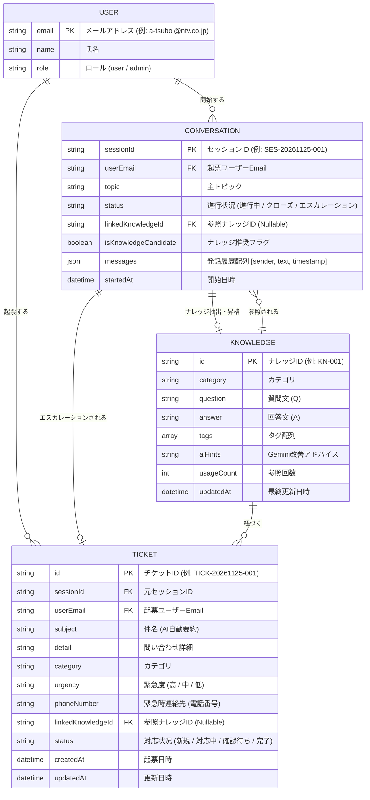

# データモデル設計書 & ER図 (Data Model & ER Diagram)

- **システム名称**: PRISM一次受けAIアシスタント (`poc-prism-inquiry`)
- **作成日**: 2026-11-25
- **バージョン**: 1.0.0
- **関連ドキュメント**: [要件定義書](requirements_definition.md)

---

## 1. エンティティ関連図 (Entity-Relationship Diagram)

---

## 2. エンティティ詳細定義

### 2.1. ユーザー (`USER`)
システム利用者の基本情報を保持するエンティティ。
PoCフェーズでは認証基盤を持たず、ヘッダーのセレクターにより擬似的に切り替える。

| カラム名 | 型 | 制約 | 説明 |
| :--- | :--- | :--- | :--- |
| **email** | string | PK | ユーザーを一意に識別するメールアドレス |
| **name** | string | Not Null | 氏名（またはパートナー企業・担当者名） |
| **role** | string | Not Null | ロール (`user`: 一般ユーザー / `admin`: 管理ユーザー) |

---

### 2.2. やり取りログ (`CONVERSATION`)
一般ユーザーとAIアシスタントのチャット対話セッションを記録するエンティティ。

| カラム名 | 型 | 制約 | 説明 |
| :--- | :--- | :--- | :--- |
| **sessionId** | string | PK | セッション識別子 (`SES-YYYYMMDD-XXX`) |
| **userEmail** | string | FK | 開始したユーザーのEmail |
| **topic** | string | | 初回質問内容からAIが推測した主トピック |
| **status** | string | Not Null | セッション状態 (`進行中` / `クローズ` / `エスカレーション`) |
| **linkedKnowledgeId** | string | FK / Nullable | 回答時に参照・引用したナレッジID |
| **isKnowledgeCandidate** | boolean | Not Null | 新規ナレッジ化推奨フラグ（AI自動判定） |
| **messages** | json | Not Null | 発話履歴配列（発話者、発話テキスト、タイムスタンプ） |
| **startedAt** | datetime | Not Null | 対話開始日時 |

---

### 2.3. チケット (`TICKET`)
自己解決せず、運用・開発チームへエスカレーションされた問い合わせエンティティ。

| カラム名 | 型 | 制約 | 説明 |
| :--- | :--- | :--- | :--- |
| **id** | string | PK | チケットID (`TICK-YYYYMMDD-XXX`) |
| **sessionId** | string | FK | エスカレーション元のやり取りセッションID |
| **userEmail** | string | FK | 起票者のEmail |
| **subject** | string | Not Null | 問い合わせ件名（Gemini自動要約初期値） |
| **detail** | string | Not Null | 問い合わせ詳細本文 |
| **category** | string | Not Null | カテゴリ（アカウント・権限 / システム不具合 / 操作方法 等） |
| **urgency** | string | Not Null | 緊急度（`高` / `中` / `低`） |
| **phoneNumber** | string | Not Null | 緊急時連絡先（電話番号） |
| **linkedKnowledgeId** | string | FK / Nullable | 紐づくナレッジID |
| **status** | string | Not Null | 対応状況 (`新規` / `対応中` / `ユーザー確認待ち` / `完了`) |
| **createdAt** | datetime | Not Null | 起票日時 |
| **updatedAt** | datetime | Not Null | 最終更新日時 |

---

### 2.4. ナレッジ (`KNOWLEDGE`)
AIチャットの回答参照元であり、運用者が継続的に保守・拡充するQ&Aエンティティ。

| カラム名 | 型 | 制約 | 説明 |
| :--- | :--- | :--- | :--- |
| **id** | string | PK | ナレッジID (`KN-XXX`) |
| **category** | string | Not Null | カテゴリ分類 |
| **question** | string | Not Null | 想定される質問文 (Q) |
| **answer** | string | Not Null | 正答・案内内容 (A) |
| **tags** | array | | 検索用キーワード・タグ配列 |
| **aiHints** | string | | Geminiによる情報の過不足・改善アドバイスコメント |
| **usageCount** | int | Default 0 | AIチャットで参照・回答に利用された回数 |
| **updatedAt** | datetime | Not Null | 最終更新日時 |

---

## 3. リレーションシップの特性と業務的意義

1. **セッションとチケットの1対1対応 (`1:1`)**:
   - チケットはやり取りログ（`CONVERSATION`）から派生するため、管理画面では起票された課題だけでなく、**「ユーザーがAIと交わした全発話ログ」を完全に再現して確認できる**。
2. **やり取りログからナレッジへの昇格 (`1:1`)**:
   - 未解決の対話ログ（`isKnowledgeCandidate: true`）から、Geminiの要約支援を受けてワンクリックで新しいナレッジ（`KNOWLEDGE`）を生成できる。
3. **ナレッジ参照回数のフィードバック**:
   - チャットでナレッジが参照されるたびに `usageCount` がインクリメントされ、よく見られているFAQが可視化される。
