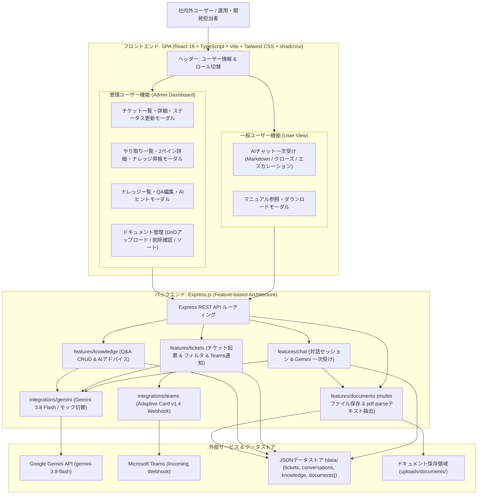

# サービス・環境定義書 (Environment & Architecture Definition)

本ドキュメントは、PRISM一次受けAIアシスタント (`poc-prism-inquiry`) の利用サービス、環境、技術スタック、およびシステムアーキテクチャ定義書です。

- **作成日**: 2026-11-25 (最新更新: 2026-11-26)
- **バージョン**: 1.3.0
- **関連ドキュメント**:
  - [要件定義書 (初版 v1.0)](requirements_v1.0_initial.md)
  - [要件定義書 (ドキュメント管理 v1.1)](requirements_v1.1_document_management.md)
  - [要件定義書 (Teams連携 v1.2)](requirements_v1.2_teams_notification.md)
  - [データモデル設計書 & ER図](data_model_er.md)
  - [Git運用・ブランチ戦略](git_structure.md)

---

## 1. システム全体像 (Architecture Overview)



---

## 2. サービス・技術スタック定義

| レイヤー | 採用技術・サービス | バージョン/詳細 | 役割・選定理由 |
| :--- | :--- | :--- | :--- |
| **ソースコード・版管理** | GitHub / GitHub CLI | `gh` / Git Flow準拠 | プルリクエスト (PR) レビュー、ブランチ運用、自動マージ管理 |
| **ランタイム** | Node.js | v20+ 推奨 | サーバーサイドおよびビルドツールの統一実行環境 |
| **フロントエンド基盤** | React + TypeScript + Vite | React 19, TypeScript 5.8, Vite 6 | 高速HMR、SPA構成、型安全なコンポーネント開発 |
| **デザインシステム** | Tailwind CSS + shadcn/ui (Radix UI) | Tailwind 4, Lucide Icons | モダンで一貫性のあるUIコンポーネント群（Button, Badge, Card, Dialog, Input, Textarea 等） |
| **バックエンド構成** | Express.js | Express 4 (Feature-based Architecture) | 機能別ドメイン分離（chat, tickets, knowledge, documents）と外部連携分離 |
| **AI推論エンジン** | Google Gemini API (`@google/genai`) | `gemini-3.8-flash` (モック自動フォールバック) | 高度な自然言語回答、チケット要約・緊急度判定、ナレッジ抽出・ヒント生成 |
| **外部通知連携** | Microsoft Teams Incoming Webhook | Adaptive Card v1.4 | チケット起票時のリアルタイム通知 & ディープリンクによる初動迅速化 |
| **ファイル処理** | `multer`, `pdf-parse` | - | PDF・Markdown等のアップロード受付、テキスト抽出、RAG展開 |
| **テストフレームワーク** | Node.js Native Test Runner | `node --test` (`scripts/run-tests.js`) | 外部テストライブラリ不要で構文・データ整合性・全サービスクラスの56件テストを高速実行 |

---

## 3. ディレクトリ構成 (Feature-based Architecture)

```text
poc-prism-inquiry/
├── docs/                               # 仕様書・設計書・環境定義・運用ガイド
│   ├── data_model_er.md                # データモデル設計書 & ER図 (v1.3.0)
│   ├── environment_definition.md       # 本ドキュメント (v1.3.0)
│   ├── git_structure.md                # Git運用・ブランチ戦略 (旧 plan_poc_prism_inquiry.md)
│   ├── prism_knowledge_summary.md      # PRISM運用定義要約
│   ├── requirements_v1.0_initial.md    # 要件定義書 [初版 v1.0]
│   ├── requirements_v1.1_document_management.md # 要件定義書 [第1回エンハンス v1.1]
│   └── requirements_v1.2_teams_notification.md  # 要件定義書 [第2回エンハンス v1.2]
├── frontend/                           # React + Vite + TypeScript フロントエンド
│   ├── src/
│   │   ├── features/                   # 機能別コンポーネント
│   │   │   ├── chat/                   # チャット一次受けビュー
│   │   │   ├── tickets/                # チケット一覧 & 詳細モーダル
│   │   │   ├── conversations/          # やり取り一覧 & ナレッジ昇格モーダル
│   │   │   ├── knowledge/              # ナレッジ一覧 & QA編集モーダル
│   │   │   ├── documents/              # ドキュメント管理 & マニュアル参照モーダル
│   │   │   └── common/                 # ヘッダー、通知トースト等
│   │   ├── components/ui/              # shadcn/ui 共通プリミティブ (Button, Dialog, Card 等)
│   │   ├── lib/                        # ユーティリティ (cn 関数等)
│   │   ├── App.tsx                     # メインレイアウト & ロール切替ステート
│   │   ├── main.tsx                    # Reactエントリーポイント
│   │   └── index.css                   # Tailwind CSS インポート
│   ├── vite.config.ts                  # Viteビルド設定 (APIプロキシ /api -> :3000)
│   └── package.json                    # フロントエンド依存関係
├── server/                             # Express バックエンド (Feature-based)
│   ├── features/                       # ドメイン機能別サービス & コントローラー
│   │   ├── chat/                       # チャット対話・Gemini回答生成
│   │   ├── tickets/                    # チケット起票・更新・ソート・Teams連携
│   │   ├── conversations/              # 対話ログ永続化・ナレッジ候補化
│   │   ├── knowledge/                  # ナレッジCRUD・Geminiアドバイス
│   │   └── documents/                  # ドキュメント登録・PDFパース・RAG抽出
│   ├── integrations/                   # 外部サービス連携レイヤー
│   │   ├── gemini/                     # Gemini 3.8 Flash SDK 連携
│   │   └── teams/                      # Microsoft Teams Adaptive Card Webhook
│   └── server.js                       # Expressエントリーポイント & SPA静的ホスティング
├── data/                               # JSONデータストア
│   ├── tickets.json                    # 起票済みチケット
│   ├── conversations.json              # やり取り履歴ログ
│   ├── knowledge.json                  # FAQ・ナレッジデータ
│   └── documents.json                  # ドキュメントメタデータ
├── uploads/                            # アップロードファイル実体保存先
│   └── documents/                      # PDF・マニュアル等実ファイル
├── scripts/                            # 自動化・運用スクリプト
│   └── run-tests.js                    # テスト一括実行 & Markdownレポート自動生成
├── test/                               # テストコード & レポート
│   ├── specs/                          # テスト仕様書
│   ├── reports/                        # テスト実行レポート
│   └── *.test.js                       # ユニットテストコード群
├── .env.example                        # 環境変数テンプレート (`GEMINI_API_KEY`, `TEAMS_WEBHOOK_URL`)
├── package.json                        # バックエンド・共通依存関係
└── README.md                           # プロジェクト概要 & クイックスタートガイド
```

---

## 4. 実行モード & 環境変数

| 環境変数名 | 必須 | デフォルト値 | 説明 |
| :--- | :---: | :--- | :--- |
| `PORT` | 任意 | `3000` | サーバー待受ポート番号 |
| `GEMINI_API_KEY` | 任意 | (未設定時はモック) | Google Gemini APIキー。未設定時はルールベースのモックエンジンで自動動作 |
| `TEAMS_WEBHOOK_URL`| 任意 | (未設定時はコンソール出力) | Microsoft Teams Incoming Webhook URL。未設定時は安全にスキップしてコンソールにカードJSONを出力 |

---

## 5. 品質保証 & 自動化テスト

本リポジトリでは品質担保のため、以下のテストスイートを標準装備している：

- **テストコマンド**: `npm test`（または `node scripts/run-tests.js`）
- **テスト対象**:
  1. シンタックス検証（全JavaScriptファイルの構文チェック）
  2. データストア整合性（JSONフォーマット検証）
  3. 環境設定検証（`.env.example` の存在確認等）
  4. 機能別サービステスト（`chat`, `tickets`, `knowledge`, `documents`, `teams`, `gemini`）
- **レポート自動生成**: テスト実行完了時、`test/reports/` 配下に日時付き Markdown レポートが自動保存される。
