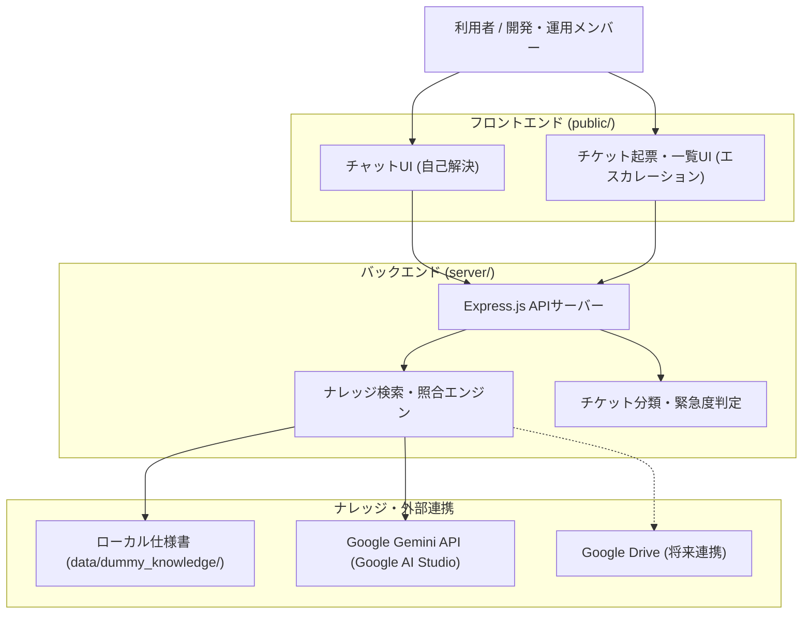

# サービス・環境定義書 (Environment & Architecture Definition)

本ドキュメントは、PRISM一次受けAIアシスタント (`poc-prism-inquiry`) の利用サービス、環境、およびアーキテクチャ定義書です。

---

## 1. システム全体像



---

## 2. サービス・技術スタック定義

| レイヤー | 採用技術・サービス | 役割・用途 | 備考 |
| :--- | :--- | :--- | :--- |
| **ソースコード・版管理** | GitHub (`a-tsuboi-cyber/poc-prism-inquiry`) | リポジトリ管理、PRレビュー、ブランチ運用 | main/featureブランチ管理 |
| **ランタイム** | Node.js (v20+ 推奨) | バックエンド実行環境 | Windows環境 |
| **バックエンドフレームワーク** | Express.js | REST APIサーバー | 対話API / エスカレーションAPI |
| **フロントエンド** | Vanilla HTML5 / CSS3 / ES Modules | チャットUI、チケット管理UI | フレームワークレスで軽量・即時起動 |
| **AI推論 (初期)** | ルールベース・モックエンジン | キーワード検索・ナレッジ照合・自動分類の即答モック | APIキー不要で初期動作検証可能 |
| **AI推論 (本番/次フェーズ)** | Google Gemini API (Google AI Studio) | 意図解釈、自然言語回答生成、チケット要約 | APIキー払い出し後に接続 |
| **ナレッジ参照 (初期)** | ローカル仕様書・FAQ Markdown (`/data/dummy_knowledge/`) | PRISM運用定義・アカウント発行等のダミー仕様書 | 初期プロトタイプ用 |
| **ナレッジ参照 (次フェーズ)** | Google Drive API (Driveプラグイン連携) | Drive上の最新設計書・マニュアルを直接取得・参照 | 運用ドキュメントと同期 |

---

## 3. ディレクトリ構成

```text
poc-prism-inquiry/
├── docs/                         # 仕様書・設計書・環境定義
│   ├── environment_definition.md # 本ドキュメント
│   ├── plan_poc_prism_inquiry.md # 実装計画書
│   └── prism_knowledge_summary.md# PRISM運用定義要約
├── data/
│   ├── dummy_knowledge/          # ダミー仕様書・FAQナレッジ
│   │   ├── account_management.md
│   │   └── system_specs.md
│   └── tickets.json              # エスカレーションされたチケット保存用
├── public/                       # フロントエンド静的ファイル
│   ├── index.html                # メイン画面（チャット & チケット切替）
│   ├── style.css                 # モダンUIスタイル
│   └── app.js                    # UIインタラクション・API通信
├── server/                       # バックエンド
│   ├── server.js                 # Expressエントリーポイント
│   ├── knowledgeService.js       # ナレッジ検索・照合
│   └── ticketService.js          # チケット起票・判定ロジック
├── .gitignore
├── package.json
└── README.md
```
