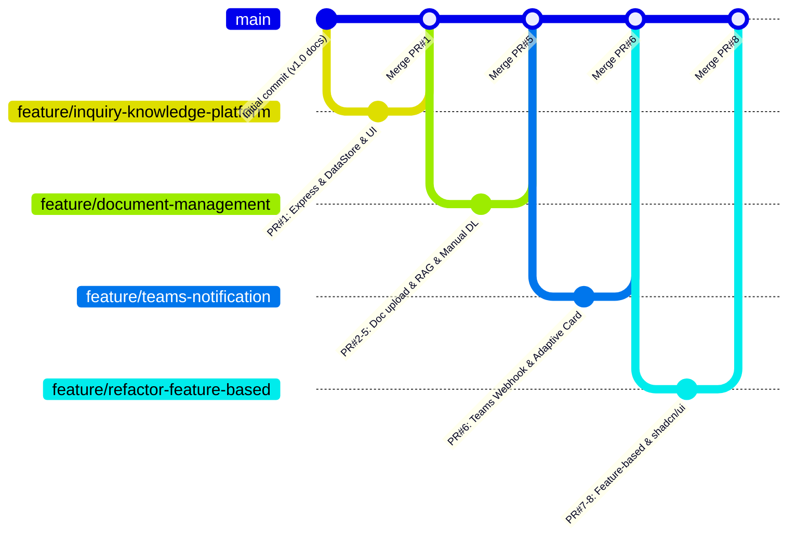

# Git運用・ブランチ戦略 & 開発フロー定義書 (Git Structure & Workflow)

- **システム名称**: PRISM一次受けAIアシスタント (`poc-prism-inquiry`)
- **作成日**: 2026-11-25 (最新更新: 2026-11-26)
- **バージョン**: 1.2.0
- **旧ドキュメント名**: `plan_poc_prism_inquiry.md` (初期実装計画書からGit運用定義書へ発展・リネーム)
- **関連ドキュメント**:
  - [要件定義書 (初版 v1.0)](requirements_v1.0_initial.md)
  - [要件定義書 (ドキュメント管理 v1.1)](requirements_v1.1_document_management.md)
  - [要件定義書 (Teams連携 v1.2)](requirements_v1.2_teams_notification.md)
  - [環境定義書](environment_definition.md)
  - [データモデル設計書](data_model_er.md)

---

## 1. ドキュメントの目的・位置づけ

本ドキュメントは、PRISM一次受けAIアシスタント開発における **Gitブランチ運用ルール、Pull Request (PR) 運用規約、およびフェーズごとの実装フロー** を定めたものです。  
本プロジェクトでは `main` ブランチを常に動作可能な保護ブランチとし、すべての機能追加・改修をフィーチャーブランチからPR経由でマージする運用を徹底しています。

---

## 2. Gitブランチモデル & ライフサイクル



### 2.1. ブランチ命名規則

| 種別 | プレフィックス | 命名例 | 説明 |
| :--- | :--- | :--- | :--- |
| **機能開発** | `feature/` | `feature/document-management`, `feature/teams-notification` | 新機能の追加、エンハンス開発 |
| **リファクタリング** | `refactor/` | `feature/refactor-feature-based` | 設計改善、ディレクトリ再構成、UI統一 |
| **バグ修正** | `fix/` | `fix/modal-scroll-issue` | 不具合の修正 |
| **ドキュメント** | `docs/` | `docs/update-spec-v1.3` | 設計書・要件定義書の更新 |

---

## 3. Pull Request (PR) & マージフロー

1. **ブランチ作成**: `main` から最新を取得し、作業ブランチを作成。
   ```powershell
   git checkout main
   git pull origin main
   git checkout -b feature/<branch-name>
   ```
2. **実装 & 単体テスト**:
   - 実装後、必ず `npm test`（56テスト）を実行し全件パスを確認。
3. **リモートPush & PR作成**:
   - GitHub CLI (`gh`) を利用してPRを作成。
   ```powershell
   git push -u origin feature/<branch-name>
   gh pr create --title "<PRタイトル>" --body "<変更内容サマリー>" --base main
   ```
4. **レビュー & マージ**:
   - 変更差分を確認後、PRを `main` へマージ（Squash & Merge または 通常Merge）。
   - マージ後はローカルの `main` を最新化。

---

## 4. プロジェクト初期構築時の実装計画 (参考アーカイブ)

本プロジェクト立ち上げ時（PR #1）に策定した初期実装スコープと検証基準です。

### 4.1. 初期フェーズ実装対象
- **データストア**: `data/{tickets, conversations, knowledge}.json`
- **バックエンド**: Express REST API (`/api/chat`, `/api/tickets`, `/api/conversations`, `/api/knowledge`)
- **フロントエンド**: ヘッダーでのロール切替（一般ユーザー / 管理ユーザー）、AIチャット一次受け、チケット起票モーダル、管理ダッシュボード（チケット一覧、やり取り一覧、ナレッジ一覧）

### 4.2. 検証項目 (Definition of Done)
- チャットによる自動回答と、解決しなかった場合のエスカレーションフォーム起動。
- 管理者画面でのチケットステータス更新、やり取りログからのナレッジ登録。
- 全体の正常動作確認および PR #1 のマージ完了。
