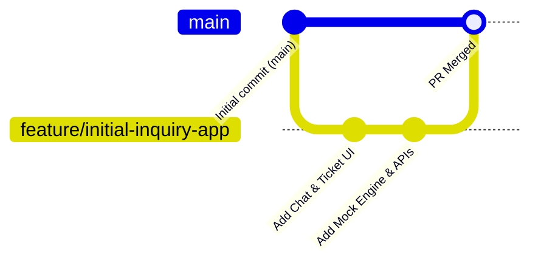

# 実装計画: PRISM一次受けAIアシスタント (poc-prism-inquiry)

ユーザーからの問い合わせを生成AIで一次受けし、未解決の場合は自動要約・カテゴリ分類・緊急度判定を行ってチケットエスカレーションするWebアプリケーションの構築計画です。

---

## ユーザー確認事項 (User Review Required)

> [!NOTE]
> 初回はAPIキー不要なモックエンジン＋ローカルナレッジで全体の骨格とGit/GitHubのPR運用フローを完成させ、次の段階でGemini APIおよびDriveナレッジ参照を接続します。

---

## 🌿 GitHub & プルリクエスト（PR）版管理フロー

1. **ステップ1: ローカル初期化 & mainブランチ初回Push**
   - リポジトリの初期化、`.gitignore`、`package.json`、`README.md`、`docs/` をコミットしてPush。
2. **ステップ2: 機能開発用ブランチ作成 (`feature/initial-inquiry-app`)**
   - チャットUI、エスカレーション機能、モックエンジンを実装。
   - 動作確認（ローカルサーバー起動テスト）。
3. **ステップ3: GitHubへPush & プルリクエスト（PR）の作成**
   - 変更をリモートブランチへPushし、GitHub上でPRを作成。
4. **ステップ4: レビュー & マージ**
   - 差分確認とマージを行い、版管理の一連の流れを完了。

---

## 📋 実装タスク一覧

- [ ] プロジェクト初期化 & Git設定 (`main`)
- [ ] バックエンドAPI実装 (`server/`)
  - `POST /api/chat`: ユーザー質問への回答生成
  - `POST /api/tickets`: チケット起票・自動分類・緊急度判定
  - `GET /api/tickets`: チケット一覧取得
- [ ] フロントエンド実装 (`public/`)
  - チャット対話UI（質問入力、回答表示、「解決した」「解決しない」ボタン）
  - エスカレーションUI（チケット自動生成フォーム、チケット管理一覧）
- [ ] ダミーナレッジ配置 (`data/dummy_knowledge/`)
  - アカウント管理、システム仕様、運用問い合わせFAQ
