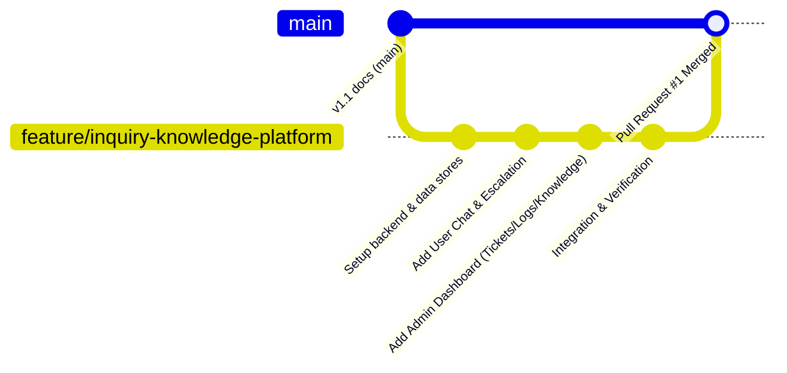

# 実装計画: PRISM一次受け & ナレッジ育成プラットフォーム (poc-prism-inquiry)

[requirements_definition.md](requirements_definition.md) v1.1.0 に基づき、一般ユーザー向けAIチャット一次受けと、管理ユーザー向けチケット・対話ログ・ナレッジ管理機能を実装・統合し、GitHub PRによる版管理を行う計画です。

---

## ユーザー確認事項 (User Review Required)

> [!NOTE]
> 本実装はすべて新ブランチ `feature/inquiry-knowledge-platform` 上で行います。
> 実装完了後、GitHub上で `main` ブランチに対するプルリクエスト（PR）を作成し、差分確認とマージを体験できるようにします。

---

## 🌿 Gitブランチ & PR運用フロー



1. **ブランチ作成**: `feature/inquiry-knowledge-platform` をローカルに作成。
2. **バックエンド & データストア構築**:
   - `data/tickets.json`, `data/conversations.json`, `data/knowledge.json` の初期データ作成。
   - Express REST API (`/api/chat`, `/api/tickets`, `/api/conversations`, `/api/knowledge`) の実装。
3. **フロントエンド実装**:
   - ヘッダー: ユーザー情報表示 & ロール切り替えセレクター（一般 / 管理者）。
   - 一般ユーザー画面: AIチャット、クローズ（「よかった！」）、エスカレーションフォーム（電話番号等入力）。
   - 管理ユーザー画面:
     - タブ1: **チケット一覧**（ソート・絞り込み・ナレッジチップ・実対話履歴モーダル & ステータス更新）
     - タブ2: **やり取り一覧**（推奨フラグ・左右2ペインポップアップ・AI要約初期値によるナレッジ登録）
     - タブ3: **ナレッジ一覧**（QA編集・AIアドバイスコメント表示）
4. **ローカル検証**: `npm start` で起動し、一般ユーザー/管理者両方のフローをテスト。
5. **リモートPush & PR作成**: GitHubへブランチをPushし、PRを作成。

---

## 🛠 提案する変更内容 (Proposed Changes)

### 1. プロジェクト基盤 & 依存関係
- `package.json` の作成（`express`, `cors` 等の軽量ライブラリを使用）。

### 2. データストア (`data/`)
- `data/knowledge.json`: 初期ナレッジ（PRISM運用定義要約から抽出したアカウント・障害・監視QA）。
- `data/conversations.json`: やり取りログの永続化とナレッジ推奨フラグ。
- `data/tickets.json`: エスカレーションチケットの永続化。

### 3. バックエンド (`server/`)
- `server/server.js`: ルーティングと静的ファイル配信。
- `server/knowledgeService.js`: ナレッジ検索、QA登録・編集、AIアドバイス生成。
- `server/conversationService.js`: 対話履歴記録、ナレッジ化サマリー生成。
- `server/ticketService.js`: チケット起票、ソート・フィルター、ステータス更新。

### 4. フロントエンド (`public/`)
- `public/index.html`: ヘッダー（ユーザー/ロール切替）、一般ユーザービュー、管理者ダッシュボードビュー、各種モーダル（チケット詳細、やり取り詳細、ナレッジ詳細）。
- `public/style.css`: モダンな管理画面デザイン（2ペイン表示、チップ、バッジ、レスポンシブ）。
- `public/app.js`: ロール切り替え制御、チャット対話、チケット起票、一覧ソート/フィルター、モーダル制御。

---

## ✅ 検証計画 (Verification Plan)

### 1. コマンドライン実行検証
```powershell
cd C:\Users\sumiy\projects\poc-prism-inquiry
npm start
```
- ポート3000でサーバーが起動し、エラーが出ないことを確認。

### 2. 一般ユーザー画面の検証
- ロール「一般ユーザー」でチャット質問（「アカウント申請方法」等）→ 関連ナレッジに基づいた回答が返ること。
- 「クローズ」ボタン → 「よかった！」が表示されること。
- 「エスカレーション」ボタン → モーダルが立ち上がり、件名・内容がAIサマリーされ、電話番号を入力してチケット送信できること。

### 3. 管理ユーザー画面の検証
- ロール「管理ユーザー」に切り替え → 管理画面が表示されること。
- **チケット管理**: ソート・絞り込みが動作し、詳細モーダルで実際のやり取りログとステータス変更ができること。
- **やり取り一覧**: 「推奨」フラグ付きの行をクリックし、左に実対話、右にAIサマリーQAが表示され、登録ボタンでナレッジに追加されること。
- **ナレッジ管理**: 登録されたナレッジが一覧に反映され、詳細モーダルでQA編集とAIヒントが確認できること。

### 4. Git & PR検証
- `git status`, `git log` でコミット履歴を確認。
- GitHubリモートへPushし、PR作成用URLを確認。
