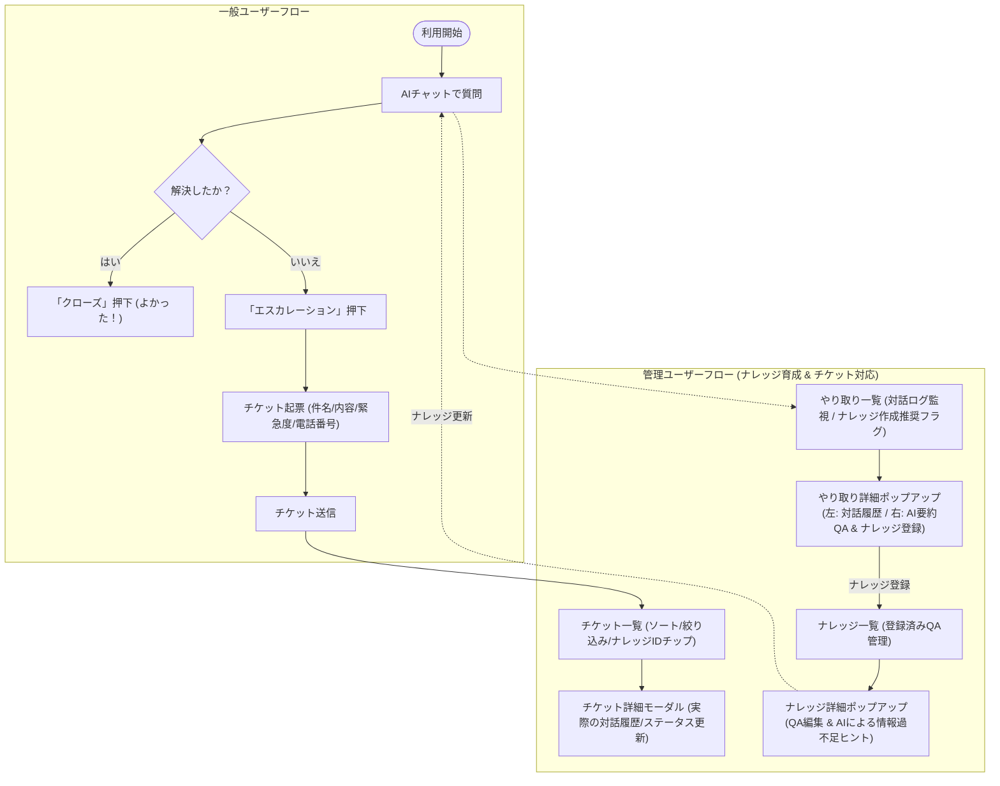

# PRISM一次受けAIアシスタント システム要件定義書 (Requirements Definition)

- **システム名称**: PRISM一次受けAIアシスタント (`poc-prism-inquiry`)
- **作成日**: 2026-11-19 (更新: 2026-11-25)
- **バージョン**: 1.1.0
- **リポジトリ**: `https://github.com/a-tsuboi-cyber/poc-prism-inquiry`

---

## 1. システム目的と背景

PRISMシステムを利用する社内外のユーザー（日本テレビ社内、およびパートナー企業：Wands / VAP / AX-ON等）からの問い合わせを生成AIで一次受けし、自己解決率の向上と運用・開発チームの問い合わせ対応負荷軽減を図る。
AIで解決しなかった場合はチケットとしてエスカレーションし、さらに実際の問い合わせログから新たなナレッジ（FAQ）を運用者がワンクリックで抽出し、継続的にナレッジを育てるサイクル（ナレッジマネジメント）を実現する。

---

## 2. 利用者（ペルソナ）とロール定義

| ロール | 想定利用者 | 主な利用機能 |
| :--- | :--- | :--- |
| **一般ユーザー (User)** | 社内各部門、パートナー企業（Wands, VAP, AX-ON等） | AIチャット問い合わせ、自己解決（クローズ）、チケットエスカレーション |
| **管理ユーザー (Admin)** | PRISM運用チーム、開発社員 | エスカレーションチケット管理、やり取り一覧からのナレッジ抽出・登録、ナレッジ一覧・編集・AIヒント |

---

## 3. 全体業務フローとナレッジ育成サイクル



---

## 4. 詳細機能要件

### 4.1. 共通基盤 & 画面制御
1. **ユーザー情報表示**:
   - 画面ヘッダー等に、現在ログイン中のユーザー情報（氏名、メールアドレス）を常時表示する。
2. **ロール切り替え機能（※PoC・デモ用モック）**:
   - 画面右上に「ロール切り替えセレクター」を配置する。
   - **選択肢**:
     1. `一般ユーザー` (例: 坪井 a-tsuboi@ntv.co.jp)
     2. `管理ユーザー` (例: 運用管理者 admin@ntv.co.jp)
   - **画面出し分け**:
     - `一般ユーザー` 選択時: チャット問い合わせ画面を表示（管理者向けメニューは非表示）。
     - `管理ユーザー` 選択時: 管理者ダッシュボード（チケット管理、やり取り一覧、ナレッジ一覧）を表示。
3. **新規チャット開始**:
   - ヘッダーまたはサイドバーに「新しい会話を開始」ボタンを常時配置し、いつでも対話セッションを初期化できる。

---

### 4.2. 一般ユーザー向け機能（チャット & 一次受け）
1. **AIチャット対話**:
   - 登録されたナレッジ（FAQ）を参照した回答生成。
   - 会話履歴を保持した連続対話。
2. **アクションボタン（入力・送信欄付近）**:
   - **「クローズ」ボタン**:
     - 押下時、「よかった！」などの完了メッセージを表示し、新規会話開始等のユーザーアクションを待機。
   - **「エスカレーション」ボタン**:
     - 押下時、チケット起票モーダルを表示：
       - **件名**: AI自動要約（初期値、ユーザー編集可）
       - **問い合わせ内容**: 会話ログを踏まえた詳細（初期値、ユーザー編集可）
       - **緊急性フラグ**: 低 / 中 / 高（初期値はAI判定、ユーザー変更可）
       - **緊急連絡先（電話番号）**: ユーザー入力欄
       - **起票者情報**: 氏名・メールアドレス（自動セット）
3. **チケット送信完了通知**:
   - 発行されたチケットIDと受付完了メッセージを表示。

---

### 4.3. 管理ユーザー向け機能

#### 4.3.1. チケット一覧 & 詳細管理
1. **チケット一覧画面**:
   - **表示項目**: チケットID、件名、起票者（氏名・メール）、カテゴリ、緊急度（バッジ）、ステータス、紐づくナレッジID（チップ表示）、起票日時。
   - **ソート機能**: 各列ヘッダーをクリックすることで昇順 / 降順のソートが可能。
   - **絞り込み（フィルター）**:
     - ステータス（新規 / 対応中 / ユーザー確認待ち / 完了）
     - 緊急度（高 / 中 / 低）
     - カテゴリ（アカウント・権限 / システム不具合 / 操作方法 / 仕様・要望 など）
2. **チケット詳細モーダル**:
   - 一覧の行クリックでモーダル表示。
   - **実際のやり取り内容（チャット履歴の全容）** を時系列で確認可能。
   - 起票者情報、緊急連絡先（電話番号）の確認。
   - 対応ステータス（新規 / 対応中 / ユーザー確認待ち / 完了）の変更および保存。

---

#### 4.3.2. やり取り一覧 & ナレッジ抽出（新機能）
ユーザーとAIの過去の実際のやり取り（セッションログ）を監視し、新たなナレッジの種を発掘する機能。

1. **やり取り一覧画面**:
   - **ヘッダー項目**:
     - セッションID、開始日時、ユーザー（氏名・メール）、主トピック（AI推測）、往復数、解決状況（クローズ / エスカレ / 途中離脱）、紐づくナレッジID（チップ表示）、**ナレッジ作成推奨フラグ（バッジ: 「推奨」）**
   - **ナレッジ作成推奨判定**:
     - 既存ナレッジで回答できずエスカレーションされたもの、またはユーザーが詳細に質問して解決した「未登録パターンの対話」に対してAIが自動で「推奨フラグ」を立てる。
2. **やり取り詳細ポップアップ（ナレッジ登録モーダル）**:
   - 行選択で2ペイン（左右分割）のポップアップを表示：
     - **左側**: **実際のやり取りログ**（ユーザーとAIの発話履歴をスクロール表示）。
     - **右側**: **ナレッジ登録フォーム**
       - **質問 (Q)**: やり取り全体からAIが抽出・サマリーした標準的な質問文（初期値入力、編集可）。
       - **回答 (A)**: やり取りで判明した適切な回答内容（初期値入力、編集可）。
       - **カテゴリ / タグ**: 推奨タグ。
       - **アクションボタン**:
         - 「キャンセル」: ポップアップを解除して一覧へ戻る。
         - 「ナレッジ登録」: ナレッジID（例: `KN-005`）を新規発番してナレッジDBに登録。完了メッセージ（トースト/アラート）を表示して一覧に戻る。

---

#### 4.3.3. ナレッジ一覧 & ナレッジ詳細編集（新機能）
登録されたナレッジ（FAQ）の保守・改善を行う画面。

1. **ナレッジ一覧画面**:
   - **ヘッダー項目**:
     - ナレッジID、カテゴリ、質問サマリー、参照回数、解決率、最終更新日時、ステータス（有効 / 無効）。
   - 検索・カテゴリ絞り込み機能。
2. **ナレッジ詳細ポップアップ**:
   - 行選択でモーダル表示。
   - **QA編集機能**: 質問文（Q）および回答文（A）、関連キーワードの直接編集・保存。
   - **AIアドバイス・ヒント（情報過不足チェック）**:
     - 登録されているQAに対して、AIが「より分かりやすくするためのヒントや不足している前提情報」をコメント形式でサジェストする。
     - 例:
       > 💡 **AIヒント**: 「パートナー企業（Wands/VAP）の場合の申請窓口が明記されていません。社外申請用のGoogleフォームのリンクを追記すると、問い合わせの再発を防止できます。」

---

## 5. データモデル (Data Model)

### 5.1. ナレッジエンティティ (`Knowledge`)
```json
{
  "id": "KN-001",
  "category": "アカウント・権限",
  "question": "パートナー企業のアカウント追加申請はどうすればよいですか？",
  "answer": "社外パートナー（Wands/VAP/AX-ON）のアカウント申請は、運用定義書第2章に基づき、専用のGoogleフォームから申請してください。主務部署の承認後、2営業日以内に発行されます。",
  "tags": ["アカウント", "パートナー", "申請"],
  "aiHints": "社外申請用フォームのURLリンクを回答に含めるとユーザーが迷いません。",
  "usageCount": 12,
  "updatedAt": "2026-11-25T16:00:00+09:00"
}
```

### 5.2. やり取りログエンティティ (`ConversationLog`)
```json
{
  "sessionId": "SES-20261125-001",
  "user": { "name": "坪井", "email": "a-tsuboi@ntv.co.jp" },
  "startedAt": "2026-11-25T15:30:00+09:00",
  "status": "エスカレーション",
  "linkedKnowledgeId": null,
  "isKnowledgeCandidate": true,
  "messages": [
    { "sender": "user", "text": "PRISMで動画のサムネイルが更新されないのですが", "timestamp": "15:30:10" },
    { "sender": "ai", "text": "サムネイルの更新にはCDNキャッシュの影響で最大15分かかります。...", "timestamp": "15:30:15" }
  ]
}
```

### 5.3. チケットエンティティ (`Ticket`)
```json
{
  "id": "TICK-20261125-001",
  "sessionId": "SES-20261125-001",
  "subject": "動画サムネイル更新の反映遅延について",
  "detail": "15分以上経過してもサムネイルが古いまま変わらない。",
  "category": "システム不具合",
  "urgency": "高",
  "phoneNumber": "090-1234-5678",
  "linkedKnowledgeId": "KN-002",
  "user": { "name": "坪井", "email": "a-tsuboi@ntv.co.jp" },
  "status": "新規",
  "createdAt": "2026-11-25T15:35:00+09:00",
  "updatedAt": "2026-11-25T15:35:00+09:00"
}
```
