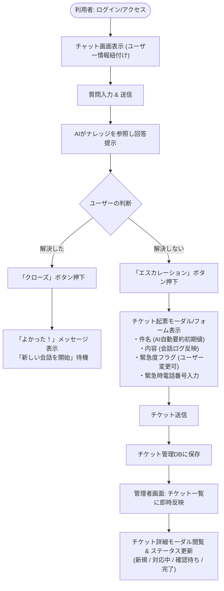

# PRISM一次受けAIアシスタント システム要件定義書 (Requirements Definition)

- **システム名称**: PRISM一次受けAIアシスタント (`poc-prism-inquiry`)
- **作成日**: 2026-11-19
- **バージョン**: 1.0.0
- **リポジトリ**: `https://github.com/a-tsuboi-cyber/poc-prism-inquiry`

---

## 1. システム目的と背景

PRISMシステムを利用する社内外のユーザー（日本テレビ社内、およびパートナー企業：Wands / VAP / AX-ON等）からの問い合わせを生成AIで一次受けし、自己解決率の向上と運用・開発チームの問い合わせ対応負荷軽減を図る。
AIで解決しなかった場合は、対話コンテキストを自動要約・分類・緊急度判定した上でチケット起票し、運用・開発チームへスムーズにエスカレーションする。

---

## 2. 利用者（ペルソナ）とロール定義

| ロール | 想定利用者 | 主な利用機能 |
| :--- | :--- | :--- |
| **一般ユーザー (User)** | 社内各部門、パートナー企業（Wands, VAP, AX-ON等） | AIチャット問い合わせ、自己解決（クローズ）、チケットエスカレーション |
| **管理者 / 運用開発 (Admin)** | PRISM運用チーム、開発社員 | エスカレーションチケット一覧閲覧、詳細モーダル確認、ステータス更新 |

> [!NOTE]
> PoCフェーズでは、画面右上の「ユーザー切替セレクター」により、認証なしで一般ユーザーと管理者の画面表示・ロールを即時切り替え可能とする。

---

## 3. 業務フローとシステム機能要件



---

## 4. 詳細機能要件

### 4.1. 共通基盤
1. **ユーザー・ロール切替機能**:
   - 画面ヘッダーにセレクターを配置（例: 一般ユーザー `坪井 (a-tsuboi@ntv.co.jp)` / パートナー担当 / 運用管理者）。
   - 選択されたユーザーの氏名・メールアドレスがセッションに保持される。
2. **ナビゲーション & 新規チャット**:
   - 画面上部またはサイドバーに「新しい会話を開始」ボタンを常時配置し、いつでも対話ログをリセット可能とする。

### 4.2. 一般ユーザー向け機能（チャット & 一次受け）
1. **AIチャット対話**:
   - 仕様書・FAQ（PRISM運用定義等）を参照した回答生成。
   - 会話履歴を保持した連続対話。
2. **アクションボタン（送信欄近接）**:
   - **「クローズ」ボタン**:
     - 押下時、「よかった！」等の完了文面を表示し、ユーザーの次のアクション（新規会話開始など）を待機。
   - **「エスカレーション」ボタン**:
     - 押下時、これまでの対話内容から以下を自動生成した入力フォームを表示：
       - **件名**: AIによる自動要約（初期値、ユーザー編集可）
       - **問い合わせ詳細**: AIが会話ログからまとめた課題内容（ユーザー編集可）
       - **緊急性フラグ**: 低 / 中 / 高（初期値はAI判定、ユーザー変更可）
       - **緊急時連絡先（電話番号）**: ユーザー入力欄（任意/必須）
       - **起票者情報**: 氏名・メールアドレス（自動セット）
3. **チケット送信完了通知**:
   - 発行されたチケットIDと受付完了メッセージを表示。

### 4.3. 管理者向け機能（チケット管理・対応）
1. **チケット一覧ダッシュボード**:
   - 起票日時、チケットID、件名、起票者（氏名・メール）、カテゴリ、緊急度（バッジ表示）、ステータスを一覧表示。
   - ステータスフィルター（すべて / 新規 / 対応中 / 完了）。
2. **チケット詳細モーダル**:
   - 一覧の行クリックでモーダル表示。
   - 問い合わせ本文、AIによる事前対話要約、起票者の緊急連絡先（電話番号）の確認。
   - **対応状況（ステータス）の変更**:
     - `新規（未対応）`
     - `対応中`
     - `ユーザー確認待ち`
     - `完了（解決済）`
   - 対応メモ・履歴の記録（任意）。

---

## 5. データ要件 (Data Model)

### 5.1. チケットエンティティ (`Ticket`)
```json
{
  "id": "TICK-20261119-001",
  "subject": "PRISMのアカウント発行手順について",
  "detail": "パートナー企業（Wands）からのアカウント追加申請方法がマニュアルで不明確だったためエスカレーション。",
  "conversationSummary": "ユーザーがWandsのアカウント申請方法を質問。AIが社内承認フローを提示したが、社外申請の個別書式について追加確認が必要となった。",
  "category": "アカウント・権限",
  "urgency": "高",
  "phoneNumber": "090-XXXX-XXXX",
  "user": {
    "name": "坪井",
    "email": "a-tsuboi@ntv.co.jp"
  },
  "status": "新規",
  "createdAt": "2026-11-19T12:30:00+09:00",
  "updatedAt": "2026-11-19T12:30:00+09:00"
}
```

---

## 6. 非機能要件 & 技術方針 (PoCフェーズ)

1. **実行環境**: Node.js + Express
2. **フロントエンド**: HTML5, CSS3, Vanilla JS（SPA構成、レスポンシブ対応）
3. **データ永続化**: ローカルJSONファイル (`data/tickets.json`)
4. **AI推論**:
   - フェーズ1: ルールベース・モックエンジン（キーワード・ナレッジ照合と自動要約モック）
   - フェーズ2: Google Gemini API (AI Studio) 連携
5. **ナレッジ管理**:
   - フェーズ1: `data/dummy_knowledge/` 配下のMarkdown仕様書
   - フェーズ2: Google Driveプラグインによる実ファイル動的参照
