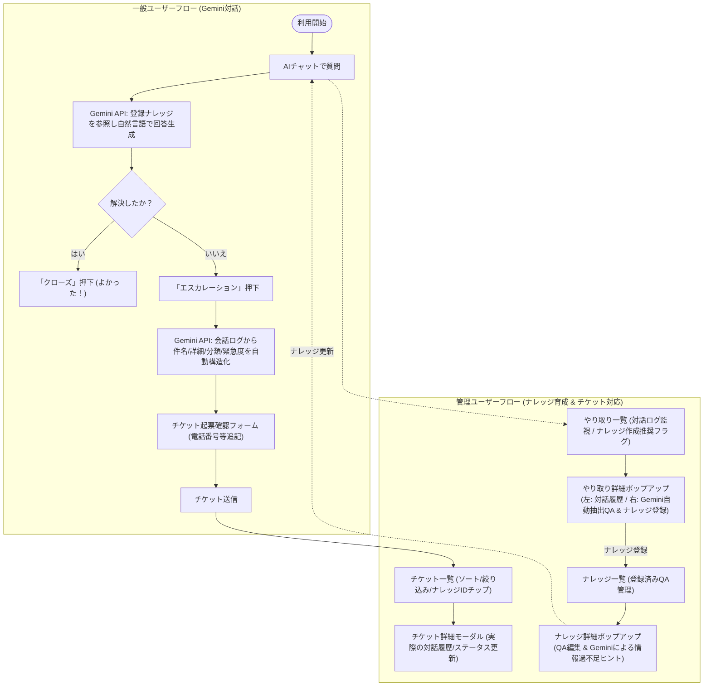

# PRISM一次受けAIアシスタント システム要件定義書 (Requirements Definition)

- **システム名称**: PRISM一次受けAIアシスタント (`poc-prism-inquiry`)
- **作成日**: 2026-11-19 (更新: 2026-11-25)
- **バージョン**: 1.2.0
- **リポジトリ**: `https://github.com/a-tsuboi-cyber/poc-prism-inquiry`
- **関連設計書**: [データモデル設計書 & ER図](data_model_er.md)

---

## 1. システム目的と背景

PRISMシステムを利用する社内外のユーザー（日本テレビ社内、およびパートナー企業：Wands / VAP / AX-ON等）からの問い合わせを生成AI（Google Gemini）で一次受けし、自然言語による高度な意図解釈と自己解決率の向上、および運用・開発チームの問い合わせ対応負荷軽減を図る。
AIで解決しなかった場合は対話コンテキストをLLMが高精度に自動要約・カテゴリ分類・緊急度判定してチケット化し、さらに過去の対話ログから新たなナレッジ（FAQ）を運用者がワンクリックで抽出し、継続的にナレッジを育てるサイクル（ナレッジマネジメント）を実現する。

---

## 2. 利用者（ペルソナ）とロール定義

| ロール | 想定利用者 | 主な利用機能 |
| :--- | :--- | :--- |
| **一般ユーザー (User)** | 社内各部門、パートナー企業（Wands, VAP, AX-ON等） | AIチャット問い合わせ（Gemini生成）、自己解決（クローズ）、チケットエスカレーション |
| **管理ユーザー (Admin)** | PRISM運用チーム、開発社員 | エスカレーションチケット管理、やり取り一覧からのナレッジ抽出・登録（Gemini要約）、ナレッジ一覧・編集・AIヒント |

---

## 3. 全体業務フローとナレッジ育成サイクル

---

## 4. 詳細機能要件

### 4.1. 共通基盤 & 画面制御
1. **ユーザー情報表示**:
   - 画面ヘッダー等に、現在ログイン中のユーザー情報（氏名、メールアドレス）を常時表示する。
2. **ロール切り替え機能（※PoC・デモ用モック）**:
   - 画面右上に「ロール切り替えセレクター」を配置（`一般ユーザー` / `管理ユーザー`）。
   - 選択されたロールに応じて一般画面と管理ダッシュボードを完全に出し分け。
3. **新規チャット開始**:
   - 「新しい会話を開始」ボタンにより、対話セッションを即時初期化。

---

### 4.2. 一般ユーザー向け機能（チャット & 一次受け）
1. **Gemini APIによる自然言語対話**:
   - ユーザーの曖昧な発話や口語表現に対しても、登録ナレッジ（FAQ）をプロンプトコンテキストとしてインプットし、適切なトーンで回答を動的生成。
   - 参照したナレッジがある場合はナレッジID（例: `KN-001`）を明記。
2. **アクションボタン（入力・送信欄付近）**:
   - **「クローズ」ボタン**: 押下時、「よかった！」等の完了メッセージを表示。
   - **「エスカレーション」ボタン**:
     - 押下時、Gemini APIが対話履歴から以下を自動生成した入力フォームを表示：
       - **件名**: Geminiによる的確な問い合わせ要約（初期値、ユーザー編集可）
       - **問い合わせ内容**: ユーザーの課題とAIの回答状況の構造化まとめ（初期値、ユーザー編集可）
       - **カテゴリ**: アカウント・権限 / システム不具合 / 操作方法 / その他（Gemini自動判定）
       - **緊急性フラグ**: 低 / 中 / 高（Gemini判定初期値、ユーザー編集可）
       - **緊急連絡先（電話番号）**: ユーザー入力欄（必須）
       - **起票者情報**: 氏名・メールアドレス（自動セット）
3. **チケット送信完了通知**: 発行チケットIDと受付完了メッセージを表示。

---

### 4.3. 管理ユーザー向け機能

#### 4.3.1. チケット一覧 & 詳細管理
1. **チケット一覧画面**:
   - 各列ソート（昇順/降順）、複合絞り込み（ステータス、緊急度、カテゴリ）、ナレッジIDチップ表示。
2. **チケット詳細モーダル**:
   - **実際のやり取り内容（全発話履歴）** を時系列で確認可能。
   - ステータス変更（新規 / 対応中 / ユーザー確認待ち / 完了）と保存。

#### 4.3.2. やり取り一覧 & ナレッジ抽出
1. **やり取り一覧画面**:
   - 過去セッション一覧、未解決・有益な対話に対する「🌟 推奨」フラグバッジ。
2. **やり取り詳細ポップアップ（左右2ペイン）**:
   - **左側**: 実際のやり取りログ。
   - **右側**: **Geminiが抽出したナレッジ登録フォーム**
     - **質問 (Q)**: やり取りからGeminiが標準化した質問文（初期値）。
     - **回答 (A)**: Geminiがまとめた汎用的な正答（初期値）。
     - **カテゴリ / タグ**: Gemini推測タグ。
     - 「キャンセル」および「ナレッジ登録」ボタン（発番・登録）。

#### 4.3.3. ナレッジ一覧 & ナレッジ詳細編集
1. **ナレッジ一覧画面**: 登録済みQA一覧、キーワード検索。
2. **ナレッジ詳細ポップアップ**:
   - QA編集・保存。
   - **Geminiによる情報過不足アドバイス（AIヒント）**:
     - 登録されたQAをGeminiが評価し、「不足している前提条件や補足URL」を改善コメントとして表示。

---

## 5. 生成AI推論 & 環境変数仕様 (Gemini API Integration)

### 5.1. モデル定義
- **利用モデル**: `gemini-3.8-flash`（環境変数 `GEMINI_MODEL` により変更可能。デフォルト: `gemini-3.8-flash`）。

### 5.2. セキュリティ & 環境変数管理
- **APIキー管理**:
  - APIキーは `.env` ファイル内の `GEMINI_API_KEY` として管理する。
  - `.env` は `.gitignore` に登録し、GitHubリポジトリへコミット・漏洩することを防止する。
  - 設定用ひな形として `.env.example` を提供する。

### 5.3. ハイブリッド・フォールバック仕様
- **自動フォールバック動作**:
  - `GEMINI_API_KEY` が未設定、または無効な場合でもシステムを停止させず、**自動的に従来のルールベース/モックエンジンにフォールバックして稼働を継続**する。
  - サーバー起動ログおよび画面コンソールにて「Gemini API Mode: ON / OFF」を明示する。

---

## 6. データモデル
各エンティティの構造、カラム定義、およびリレーションシップの詳細は、独立ドキュメント [データモデル設計書 & ER図](data_model_er.md) を参照すること。
