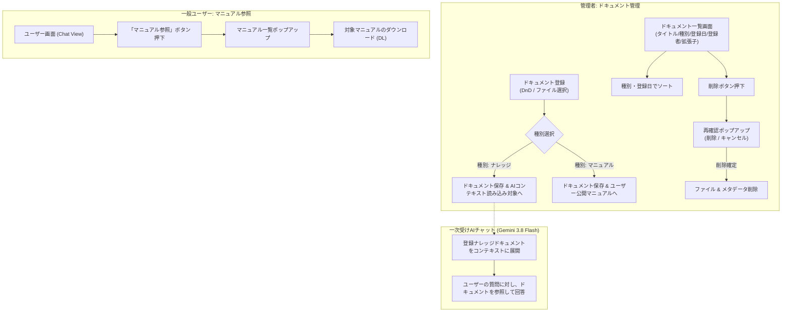
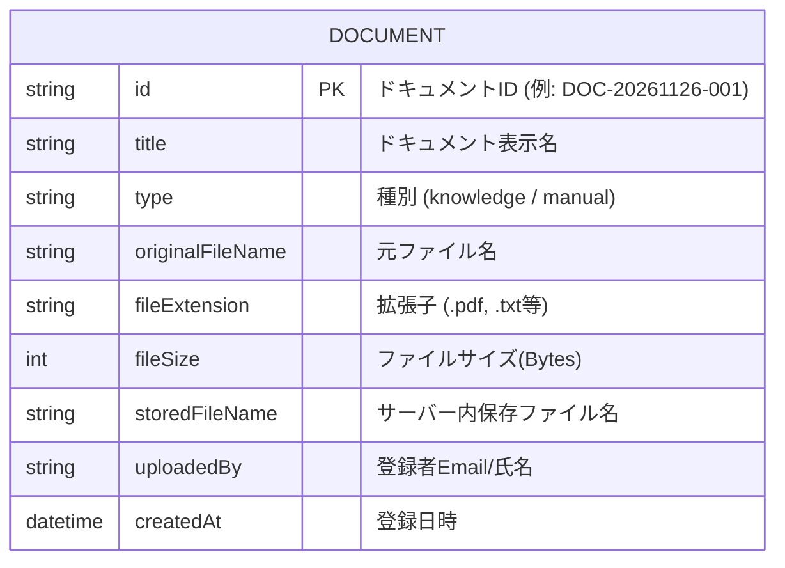

# PRISM ドキュメント管理・マニュアル参照機能 要件定義書

- **システム名称**: PRISM一次受けAIアシスタント (`poc-prism-inquiry`)
- **機能名称**: ドキュメント管理（ナレッジ元データ登録 & ユーザーマニュアル参照）
- **作成日**: 2026-11-26
- **バージョン**: 1.0.0
- **関連ドキュメント**: [全体システム要件定義書](requirements_definition.md) / [データモデル設計書 & ER図](data_model_er.md)

---

## 1. 機能目的と背景

従来のナレッジは管理者がQ&A形式で直接登録する仕様だったが、実務では「社内マニュアル」「業務手順書」「仕様書ドキュメント」がPDFやテキストで既に存在していることが多い。
本機能により以下の2つの業務価値を実現する：
1. **ナレッジ拡充**: 管理者がドキュメント（種別: ナレッジ）をアップロードすると、AI（Gemini）がその内容を読み込み、一次受けチャットの回答精度を向上させる。
2. **自己解決支援**: 管理者がアップロードしたドキュメント（種別: マニュアル）を、一般ユーザー画面から一覧閲覧・ダウンロードできるようにし、マニュアル参照による自己解決を促進する。

---

## 2. 業務フロー

---

## 3. 機能要件詳細

### 3.1. 管理者画面: ドキュメント一覧機能 (`Documents Tab`)
1. **ナビゲーション追加**:
   - 管理者ダッシュボードのタブ（チケット / やり取り / ナレッジ）に **「📄 ドキュメント」** タブを追加。
2. **一覧テーブル構成**:
   - ヘッダー項目:
     - **タイトル**: ドキュメント名称（アップロード時に指定、またはファイル名初期値）
     - **種別**: `ナレッジ` または `マニュアル`（色分けバッジ表示）
     - **登録日**: `YYYY-MM-DD HH:mm` 形式
     - **登録者**: 登録ユーザー名 / Email（例: `坪井 (a-tsuboi@ntv.co.jp)`）
     - **ファイルタイプ**: 拡張子（`.pdf`, `.txt`, `.md`, `.docx` 等）
     - **アクション**: 削除ボタン（ゴミ箱アイコン）
3. **ソート機能**:
   - 「種別」でのグループ・並び替え（ナレッジ優先 / マニュアル優先）。
   - 「登録日」でのソート（新しい順 / 古い順）。
4. **新規登録ボタン**:
   - テーブル上部に「➕ ドキュメント登録」ボタンを配置。
5. **削除処理 & 再確認ポップアップ**:
   - 削除ボタン押下時、即時削除せず **「再確認モーダル」** を表示。
   - モーダル文言: 「ドキュメント『〇〇』を削除しますか？紐づくマニュアルダウンロードやAI参照が無効になります。」
   - 選択肢: 「キャンセル」「削除する（赤ボタン）」

---

### 3.2. 管理者画面: ドキュメント登録ポップアップ (`Upload Modal`)
1. **ファイル入力 (1ファイル単位)**:
   - ドラッグ＆ドロップ（DnD）エリアの提供。
   - クリックでOSのエクスプローラー（ファイルピッカー）が起動。
   - 対象拡張子: `.txt`, `.md`, `.pdf`, `.csv`, `.docx`, `.json` など。
2. **入力項目**:
   - **ドキュメントタイトル**: 必須（ファイル選択時に自動でファイル名が初期セットされ、編集可能）。
   - **種別選択**: ラジオボタンまたはセレクトボックス
     - `ナレッジ`（AI回答の参照元として利用）
     - `マニュアル`（一般ユーザーへの配布用）
3. **ボタンアクション**:
   - 「キャンセル」: ポップアップを閉じ、入力破棄。
   - 「登録」: サーバーへアップロード処理を実行。
4. **完了後挙動**:
   - アップロード成功後、ポップアップを自動で閉じ、ドキュメント一覧を即時再描画。

---

### 3.3. AI回答へのナレッジドキュメント読み込み
1. **対象**: 種別が `ナレッジ` として登録されているドキュメント。
2. **反映方法**:
   - テキスト系ファイル（`.txt`, `.md`, `.csv`, `.json` 等）の内容を抽出。
   - チャット対話時に、既存の `knowledge.json` に加えて、登録されたナレッジドキュメントの本文を Gemini のコンテキスト（システムプロンプト）に動的注入。
   - Geminiがドキュメント内の手順や記載を参照してユーザーの質問に回答。

---

### 3.4. 一般ユーザー画面: マニュアル参照 & ダウンロード機能
1. **導線設置**:
   - 一般ユーザー画面（Chat画面）のヘッダー近接、またはチャットエリア上部に **「📚 マニュアル一覧」** ボタンを設置。
2. **マニュアル参照ポップアップ**:
   - 種別が `マニュアル` のドキュメントのみを一覧表示。
   - 表示項目: タイトル、ファイル名、サイズ、更新日、ダウンロード（DL）ボタン。
3. **ダウンロード処理**:
   - ダウンロードボタン押下で、ブラウザ経由で対象ファイルをローカルに保存できる。

---

## 4. データモデル定義

データストア: `data/documents.json`  
実ファイル保存先: `uploads/documents/`

---

## 5. APIエンドポイント設計

| メソッド | パス | 説明 |
| :--- | :--- | :--- |
| `GET` | `/api/documents` | ドキュメント一覧取得（`?type=manual` 等の絞り込み、ソート対応） |
| `POST` | `/api/documents` | ドキュメント登録（multipart/form-data: ファイル、タイトル、種別） |
| `DELETE` | `/api/documents/:id` | ドキュメント削除（実ファイルおよびメタデータ削除） |
| `GET` | `/api/documents/:id/download` | ファイルダウンロード（一般ユーザー/管理者共用） |

---

## 6. 単体テスト計画 (Unit Test Criteria)

本機能実装後、共通スキル `auto-tester` により以下のテストを実施する：
1. **共通チェック**: 新規エンドポイント・サービスの構文チェック、アップロードディレクトリ存在チェック。
2. **モジュールテスト (`documentService.test.js`)**:
   - ドキュメント登録・一覧取得・ID取得。
   - 種別別（ナレッジ / マニュアル）の絞り込み・ソート動作検証。
   - 削除処理（ファイルとメタデータの削除）の検証。
   - ダウンロード時のファイル存在確認。
