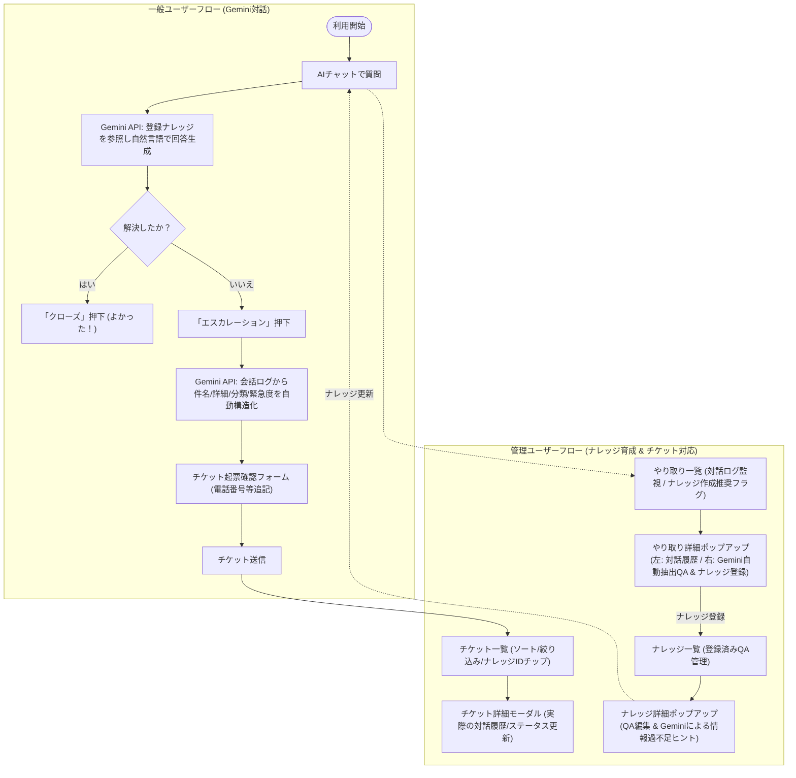

# [初版 v1.0] PRISM一次受けAIアシスタント システム要件定義書

- **システム名称**: PRISM一次受けAIアシスタント (`poc-prism-inquiry`)
- **作成日**: 2026-11-19 (更新: 2026-11-25)
- **バージョン**: 1.0.0
- **リポジトリ**: `https://github.com/a-tsuboi-cyber/poc-prism-inquiry`
- **関連ドキュメント**: 
  - [データモデル設計書 & ER図](data_model_er.md)
  - [サービス・環境定義書](environment_definition.md)
  - [Git運用・ブランチ戦略](git_structure.md)
  - [要件定義書 (第1回エンハンス: ドキュメント管理 v1.1)](requirements_v1.1_document_management.md)
  - [要件定義書 (第2回エンハンス: Teams通知連携 v1.2)](requirements_v1.2_teams_notification.md)

---

## 1. システム目的と背景

PRISMシステムを利用する社内外のユーザー（日本テレビ社内、およびパートナー企業：Wands / VAP / AX-ON等）からの問い合わせを生成AI（Google Gemini）で一次受けし、自然言語による高度な意図解釈と自己解決率の向上、および運用・開発チームの問い合わせ対応負荷軽減を図る。
AIで解決しなかった場合は対話コンテキストをLLMが高精度に自動要約・カテゴリ分類・緊急度判定してチケット化し、さらに過去の対話ログから新たなナレッジ（FAQ）を運用者がワンクリックで抽出し、継続的にナレッジを育てるサイクル（ナレッジマネジメント）を実現する。

---

## 2. 利用者（ペルソナ）とロール定義

| ロール | 想定利用者 | 主な利用機能 |
| :--- | :--- | :--- |
| **一般ユーザー (User)** | 社内各部門、パートナー企業（Wands, VAP, AX-ON等） | AIチャット問い合わせ（Gemini生成）、自己解決（クローズ）、チケットエスカレーション |
| **管理ユーザー (Admin)** | PRISM運用チーム、開発社員 | エスカレーションチケット管理、やり取り一覧からのナレッジ抽出・登録（Gemini要約）、ナレッジ一覧・編集・AIヒント |

---

## 3. 全体業務フローとナレッジ育成サイクル

---

## 4. 機能要件一覧

### 4.1. ヘッダー・共通機能
1. **ユーザー・ロール切替セレクター**:
   - `坪井 (a-tsuboi@ntv.co.jp)` / 一般ユーザー
   - `運用管理者 (admin@ntv.co.jp)` / 管理ユーザー
   - セレクター変更により即座にユーザー画面と管理者ダッシュボードが切り替わる。

### 4.2. 一般ユーザー画面 (User View)
1. **AIチャット一次受け**:
   - 自然言語による質問入力とGemini 3.8 Flashによる回答（Markdownレンダリング対応）。
   - 回答に関連ナレッジIDの引用表示。
2. **解決判定（クローズ）**:
   - 「クローズ」ボタン押下で「解決済み」モーダル表示。「よかった！」フィードバック。
3. **エスカレーション（チケット起票）**:
   - AI回答で解決しない場合、「エスカレーション」ボタン押下。
   - 会話ログからGeminiが件名・詳細・カテゴリ・緊急度を自動抽出した入力モーダルが起動。
   - 緊急度「高」選択時は緊急連絡先（電話番号）の入力が可能。

### 4.3. 管理者ダッシュボード (Admin Dashboard)
1. **チケット管理タブ**:
   - 起票済みチケットの一覧表示（ID、件名、カテゴリ、緊急度、起票者、日時、ステータス）。
   - 緊急度・ステータス・カテゴリによる絞り込み & ソート。
   - チケット行クリックで詳細モーダル起動（起票時の全チャットログの完全再現表示、対応ステータス変更）。
2. **やり取り一覧タブ**:
   - 全セッションの対話履歴ログ一覧表示。
   - 未解決対話ログに対する「ナレッジ推奨」バッジ表示。
   - 行クリックで2ペインモーダル起動（左: 実際の対話履歴、右: Gemini要約済みの質問・回答・タグ）。「ナレッジ登録」ボタン押下でナレッジへ即座に追加。
3. **ナレッジ管理タブ**:
   - 登録済みQ&Aナレッジの一覧表示（ID、カテゴリ、質問、参照回数、更新日）。
   - 行クリックで詳細モーダル起動（Q&Aの編集保存、Geminiによるナレッジ改善アドバイスの表示）。
