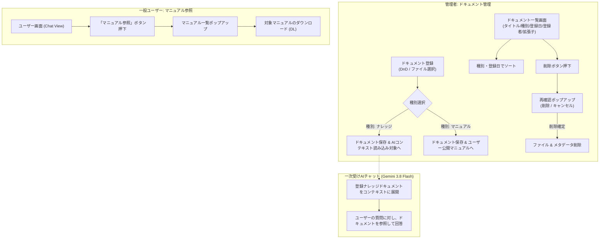

# [第1回エンハンス v1.1] ドキュメント管理・マニュアル参照機能 要件定義書

- **システム名称**: PRISM一次受けAIアシスタント (`poc-prism-inquiry`)
- **機能名称**: ドキュメント管理（ナレッジ元データ登録 & ユーザーマニュアル参照）
- **作成日**: 2026-11-26
- **バージョン**: 1.1.0
- **関連ドキュメント**: 
  - [要件定義書 (初版 v1.0)](requirements_v1.0_initial.md)
  - [要件定義書 (第2回エンハンス: Teams通知連携 v1.2)](requirements_v1.2_teams_notification.md)
  - [データモデル設計書 & ER図](data_model_er.md)
  - [サービス・環境定義書](environment_definition.md)
  - [Git運用・ブランチ戦略](git_structure.md)

---

## 1. 機能目的と背景

従来のナレッジは管理者がQ&A形式で直接登録する仕様だったが、実務では「社内マニュアル」「業務手順書」「仕様書ドキュメント」がPDFやテキストで既に存在していることが多い。
本機能により以下の2つの業務価値を実現する：
1. **ナレッジ拡充**: 管理者がドキュメント（種別: ナレッジ）をアップロードすると、AI（Gemini）がその内容を読み込み、一次受けチャットの回答精度を向上させる（RAG連携）。
2. **自己解決支援**: 管理者がアップロードしたドキュメント（種別: マニュアル）を、一般ユーザー画面から一覧閲覧・ダウンロードできるようにし、マニュアル参照による自己解決を促進する。

---

## 2. 業務フロー

---

## 3. 機能要件詳細

### 3.1. 管理者: ドキュメント管理タブ
- **アップロード機能**:
  - ドラッグ＆ドロップまたはファイル選択ダイアログ。
  - 対応拡張子: `.pdf`, `.txt`, `.md`, `.docx`（PDF変換/テキスト抽出）。
  - アップロード時にタイトルと種別（`ナレッジ` / `マニュアル`）を指定。
- **一覧表示 & ソート**:
  - タイトル、種別バッジ、登録日時、登録者、ファイルサイズを表示。
  - 種別（ナレッジ/マニュアル）および登録日によるソート。
- **削除機能**:
  - 削除ボタン押下時に「削除確認ポップアップ」を表示。誤操作を防止。

### 3.2. 一般ユーザー: マニュアル参照モーダル
- ヘッダーまたはチャット画面上部に「マニュアル参照」ボタンを配置。
- クリックで公開中のマニュアル（`type: manual`）一覧がモーダルで表示。
- ワンクリックでダウンロード可能。

### 3.3. バックエンド & AI連携
- アップロードされたファイルは `uploads/documents/` にセキュアに保存。
- メタデータは `data/documents.json` で永続化。
- `pdf-parse` 等を用いてテキストを抽出し、一次受けチャット時のGeminiプロンプトコンテキストへ自動注入。
